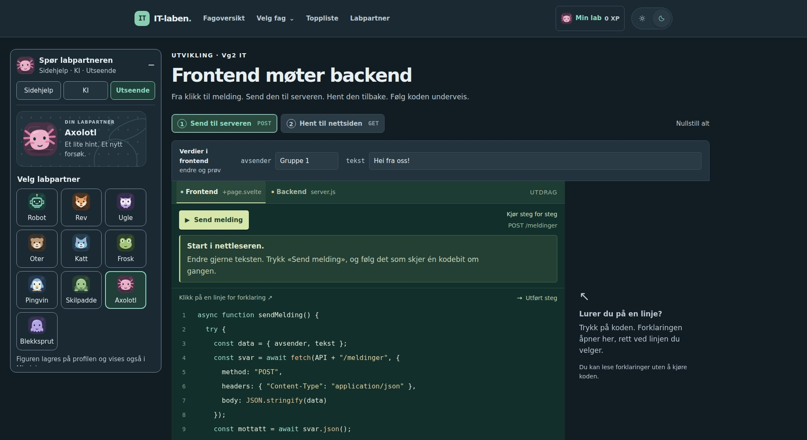
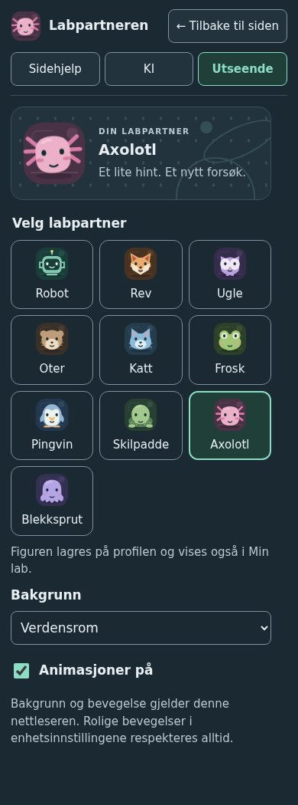

# Avatarer og tryggere lagring

## Velg en avatar

Åpne **Labpartner → Utseende** og velg robot, rev, ugle, oter, katt, frosk, pingvin, skilpadde, axolotl eller blekksprut. Alle ti er tilgjengelige fra start. Et trykk lagrer figuren på den innloggede profilen; gjester lagrer valget i nettleseren. **Min lab → Tilpass labkortet** har fortsatt det samme avatarvalget og sin vanlige lagreknapp. Profilfiguren følger kontoen ved ny pålogging og vises på labkortet, i Min lab-lenken og på topplisten.

Under **Utseende** kan eleven også velge laboratorium, verdensrom eller hage som bakgrunn og slå animasjoner av eller på. Disse valgene gjelder nettleseren. Nye figurer bruker det eksisterende profilfeltet; utvidelsen krever ingen databasemigrasjon. Gamle ID-er og figurvalg beholdes. Et mislykket profilvalg viser en feil og beholder den lagrede figuren.

Figurene har skygge, lysdetaljer og korte reaksjoner ved åpning, arbeid, venting og svar. Blink, hilsen og bevegelser i finner og armer er avgrenset til noen sekunder, uten evige animasjonssløyfer. Eksisterende aktivitetstilbakemeldinger beholdes; avatarvalg og reaksjoner gir aldri XP. Historiske eller dupliserte serverkvitteringer utløser ingen ny resultatreaksjon. En smilende figur etter et KI-svar betyr at et svar er klart, ikke at det faglige innholdet er godkjent.

### Tilgjengelighet og plassering

Labpartneren finnes på alle vanlige sider, også forsiden, modulene, Min lab og topplisten. Lærer- og administratorsider har ikke labpartner. **Labpartner** i hovedmenyen åpner den også når den er skjult. Presentasjonsvisningen på storskjerm beholder den rolige visningen uten elevverktøy.

- Fra **1800 CSS-piksler** har den generelle labpartneren en 360 piksler bred venstrespalte med plass til innvendig rulling. Oppgaven beholder sin lesebredde, og panelet har luft til vinduskanten.
- På mindre skjermer åpner den kompakte knappen en dialog. Fra 601 piksler er dialogen sentrert; på smalere skjermer fyller den skjermen. **Tilbake til siden** og Escape gjenoppretter fokus og rulleposisjon.
- Redd chatten beholder sin lokale plassering ved kodearbeidet: egen venstrespalte på brede skjermer, under testområdet på vanlige skjermer og dialog på mobil.

Skrivefeltet står over svarene, og nyeste svar vises først. Se [labpartnerens sidehjelp og KI-kontekst](labpartner-ki-pilot.md). En ny melding åpner ikke et lukket panel. Samtalelengde skal ikke flytte oppgavens testkontroller. Bruddpunktene er lokale designvalg, ikke standardkrav.

Animasjonene respekterer både **Rolige animasjoner / Animasjoner på** og enhetens innstilling for redusert bevegelse. **Min lab → Lyd og animasjoner → Vis labpartneren på sidene** styrer synligheten i nettleseren. Redd chattens eksisterende **Skjul labpartneren** flytter fokus til hovedinnholdet. Hovedmenyen kan alltid åpne den igjen.

Figurene er lokale SVG-er uten eksterne bildefiler, opplastinger eller sporing. Stabile ID-er ligger i `src/lib/avatars.js`, tegning og animasjoner i `Avatar.svelte`, og reaksjonssignalene i `avatarFeedback.js`. `GlobalLabPartner` eier den generelle plasseringen, mens Redd chatten har sin lokale integrasjon og `AvatarCompanion`. Nye aktiviteter kan melde konkrete resultater med `avatarFeedback(activityId, mood, message)`. Slike reaksjoner lagres ikke som KI-kontekst på de generelle sidene.

Grensesnittet kontrolleres med begge temaer, tastatur, berøring, 320–1920 CSS-piksler, 200 % tekst, økt tekstavstand og begge innstillinger for redusert bevegelse. Se kontrollresultatene i [KI-beskrivelsen](labpartner-ki-pilot.md#kontroll). Brukertesting med elever gjenstår. Reaksjonene støtter videre forsøk og dokumenterer ikke forståelse; aktivitetenes faglige kontroller er uendret.

## Bytt nøkkelfil uten å miste tilgang

1. Åpne **Min lab → Profil og nøkkelfil → Lag ny nøkkelfil**.
2. Velg **Lag den nye filen**, og deretter **Last ned ny nøkkelfil**.
3. Kontroller at filen er lagret, kryss av og velg **Bekreft nøkkelbyttet**.

Den gamle nøkkelen og alle pålogginger virker frem til bekreftelsen. En klargjort fil kan ikke brukes til innlogging før den er aktivert. Den må bekreftes innen 30 minutter; ellers lages en annen fil. Å avbryte eller lukke siden før bekreftelse endrer ikke tilgangen.

Når eleven bekrefter, aktiveres filen som allerede er lastet ned. Den gamle nøkkelen sperres, andre enheter logges ut og den nåværende økten beholdes. Et tapt svar kan derfor ikke fjerne begge innloggingsmulighetene. Samme bekreftelse kan sendes på nytt uten å logge ut en ny innlogging med den nye filen. En annen klargjort fil fra før byttet kan ikke aktivere en gammel klargjøring i ettertid.

API-et bruker `POST /api/auth/prepare-key` med `accountId`, deretter `POST /api/auth/rotate-key` med `accountId`, den nye filens `key` og `confirmed: true`. Begge krever innlogging, Origin og CSRF. Bare nøkkelhash lagres på serveren, og hemmeligheten havner aldri i localStorage. En gammel nettleserfane som prøver det tidligere ett-trinnsbyttet avvises uten å endre nøkkelen. Last siden på nytt før bytte etter oppdatering.

Hvis eleven har mistet både nøkkelfilen og alle pålogginger, kan en administrator på dev bruke **Elever → velg elevprofil → Gi ny nøkkelfil**. Dette gir tilgang til den samme elevprofilen og bevarer serverlagret progresjon. Se [elevadministrasjon](elevadministrasjon.md#mistet-nøkkelfil-gi-eleven-tilgang-igjen) for klargjøring, nedlasting og aktivering. Elevens selvbetjente nøkkelbytte ovenfor krever fortsatt en eksisterende pålogging.

## Fremgang fra flere faner

Hvert ventende forsøk har sin egen lokale oppføring i stedet for at hver fane erstatter hele kontokøen. Fanene varsler hverandre om endringer. En bekreftet innsending fjerner bare sin egen hendelses-ID. Samtidige gjeninnsendinger tåles av serverens eksisterende kvitteringer og unike belønningsnøkler.

Gamle køer migreres automatisk med de opprinnelige konto-, hendelses-, oppdrags-, øvings- og åpnings-ID-ene. Avbrytes migreringen, beholdes den gamle køen til flyttingen kan fullføres. Hendelser fra andre kontoer blir ikke sendt inn på den påloggede kontoen. Ved manglende lokal lagring beholdes arbeid i fanen og eleven får beskjed om å holde den åpen.

Oppdater allerede åpne faner etter publisering slik at alle bruker den nye køen. Nattevaktens serverlagrede utkast og versjonskontroll beholdes; denne endringen gjelder køen for innsending av fremgang og ferdige forsøk.

## Database og kontroll

Migrasjon `008_avatars_and_pending_keys.sql` legger til `lab_profiles.avatar_id` og `pending_recovery_keys`. Eksisterende profiler får robot som standard. Navn, farge, merke, poeng, progresjon og aktiv nøkkel beholdes. Backup tar også med de nye feltene. Bruk en API-versjon som forstår skjema 008 ved tilbakeføring.

`npm test` dekker blant annet flere køinstanser, omlasting, kontoisolasjon, gammel kø, lagringsfeil, tapt nøkkelsvar, ugyldig og utløpt klargjøring, bekreftelsesretry, avatarvalidering, topplisterespons og oppgradering av eksisterende labkort. Kjør også `npm run check` og `npm run build` før publisering.
