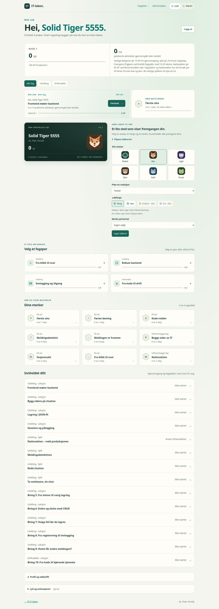
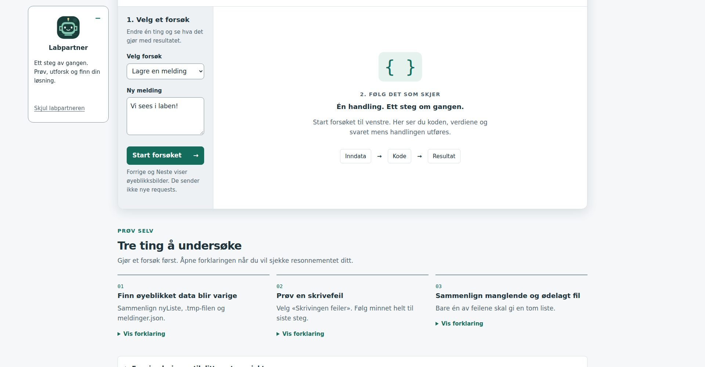
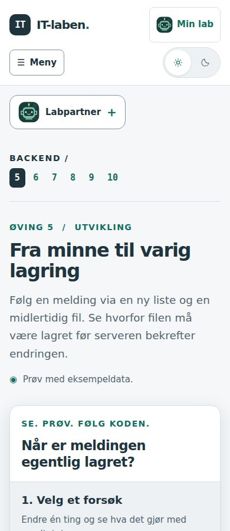
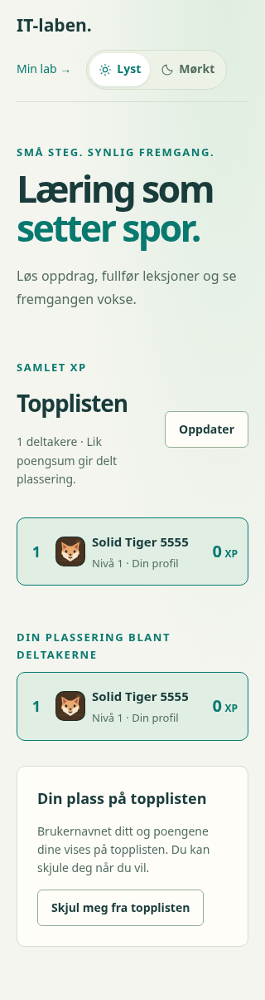

# Avatarer og tryggere lagring

Denne versjonen utvikles på `dev`. Skoleserveren publiserer fremdeles bare `main`.

## Velg en avatar

Åpne **Min lab → Tilpass labkortet**. Velg mellom robot, rev, ugle, oter, katt og frosk, og trykk **Lagre labkort**. Alle seks er tilgjengelige fra start. Avataren følger kontoen ved ny pålogging og vises på labkortet, i Min lab-lenken og på topplisten, også på mobil.

Under elevaktiviteter vises en kompakt labpartner. Den reagerer når eleven jobber, undersøker en forklaring, finner en feil eller løser en oppgave. Feil får en oppmuntrende reaksjon. Spillforsøk og serverbekreftede resultater gir egne tilbakemeldinger; avatarvalg og reaksjoner gir aldri XP. Historiske eller dupliserte serverkvitteringer utløser ingen ny resultatreaksjon.

### Plassering og sammenlegging

- Fra **1800 CSS-piksler** i nettleservinduet står labpartneren i venstremargen og følger rullingen. Oppgaven beholder bredden og plasseringen sin. Panelet er 220 piksler bredt og kan rulles innvendig når forstørret tekst eller et lavt vindu krever det.
- Mellom **601 og 1799 piksler** ligger den over aktiviteten og ruller bort sammen med siden.
- På **600 piksler og smalere** starter den som en liten knapp over aktiviteten. Eleven åpner meldingen ved behov.

Trykk **Labpartner** for å åpne eller slå sammen meldingen. Valget huskes separat for de tre skjermbreddene så lenge komponenten er montert; en ny melding åpner ikke et sammenlagt panel. Dette er lokale designvalg som gir plass til oppgaven, ikke bestemte bruddpunkter fra en standard.

Animasjonene er korte og respekterer både **Rolige animasjoner** og PC-ens innstilling for redusert bevegelse. **Skjul labpartneren** slår den helt av og flytter tastaturfokus til hovedinnholdet. Den kan slås på igjen under **Min lab → Lyd og animasjoner**. Denne innstillingen gjelder nettleseren og beholdes ved omlasting. Lærervisning og storskjermgjennomgang viser ikke elevens labpartner.

Plasseringen er kontrollert på alle 14 aktivitetssider ved 1920 pikslers bredde, med flere skjermbredder fra 320 til 1800 piksler på representative sider. Nettleserprøvene dekker rulling, tastatur, berøring, begge temaer, forstørret tekst på 200 %, tekstavstand, skjuling og gjenåpning. En avgrenset axe-kontroll av labpartneren ga ingen funn; dette er ikke en full tilgjengelighetsrevisjon. `npm run check`, `npm run build` og den eksisterende testen for avatarreaksjoner er bestått. Svelte MCP var ikke tilgjengelig; offisiell Svelte-dokumentasjon ble brukt. Brukertesting med elever gjenstår. Reaksjonene støtter elevens videre forsøk og dokumenterer ikke forståelse; aktivitetenes faglige kontroller er uendret.

Figurene er lokale SVG-er uten eksterne bildefiler, opplastinger eller sporing. Stabile avatar-ID-er ligger i `src/lib/avatars.js`, tegning og animasjoner i `Avatar.svelte` og reaksjonssignalene i `avatarFeedback.js`. Nye aktiviteter bruker den samme `AvatarCompanion` og kan melde konkrete resultater med `avatarFeedback(activityId, mood, message)`. Eleven velger figur én gang; utviklings- og driftsinnhold bruker samme profilfelt. Behold gamle avatar-ID-er ved utvidelser.

## Bytt nøkkelfil uten å miste tilgang

1. Åpne **Min lab → Profil og nøkkelfil → Lag ny nøkkelfil**.
2. Velg **Lag den nye filen**, og deretter **Last ned ny nøkkelfil**.
3. Kontroller at filen er lagret, kryss av og velg **Bekreft nøkkelbyttet**.

Den gamle nøkkelen og alle pålogginger virker frem til bekreftelsen. En klargjort fil kan ikke brukes til innlogging før den er aktivert. Den må bekreftes innen 30 minutter; ellers lages en annen fil. Å avbryte eller lukke siden før bekreftelse endrer ikke tilgangen.

Når eleven bekrefter, aktiveres filen som allerede er lastet ned. Den gamle nøkkelen sperres, andre enheter logges ut og den nåværende økten beholdes. Et tapt svar kan derfor ikke fjerne begge innloggingsmulighetene. Samme bekreftelse kan sendes på nytt uten å logge ut en ny innlogging med den nye filen. En annen klargjort fil fra før byttet kan ikke aktivere en gammel klargjøring i ettertid.

API-et bruker `POST /api/auth/prepare-key` med `accountId`, deretter `POST /api/auth/rotate-key` med `accountId`, den nye filens `key` og `confirmed: true`. Begge krever innlogging, Origin og CSRF. Bare nøkkelhash lagres på serveren, og hemmeligheten havner aldri i localStorage. En gammel nettleserfane som prøver det tidligere ett-trinnsbyttet avvises uten å endre nøkkelen. Last siden på nytt før bytte etter oppdatering.

Dette endrer nøkkelbyttet. Hvis eleven har mistet både nøkkelfilen og alle pålogginger, finnes det fremdeles ingen automatisk kontogjenoppretting gjennom lærerpanelet.

## Fremgang fra flere faner

Hvert ventende forsøk har sin egen lokale oppføring i stedet for at hver fane erstatter hele kontokøen. Fanene varsler hverandre om endringer. En bekreftet innsending fjerner bare sin egen hendelses-ID. Samtidige gjeninnsendinger tåles av serverens eksisterende kvitteringer og unike belønningsnøkler.

Gamle køer migreres automatisk med de opprinnelige konto-, hendelses-, oppdrags-, øvings- og åpnings-ID-ene. Avbrytes migreringen, beholdes den gamle køen til flyttingen kan fullføres. Hendelser fra andre kontoer blir ikke sendt inn på den påloggede kontoen. Ved manglende lokal lagring beholdes arbeid i fanen og eleven får beskjed om å holde den åpen.

Oppdater allerede åpne faner etter publisering slik at alle bruker den nye køen. Nattevaktens serverlagrede utkast og versjonskontroll beholdes; denne endringen gjelder køen for innsending av fremgang og ferdige forsøk.

## Database og kontroll

Migrasjon `008_avatars_and_pending_keys.sql` legger til `lab_profiles.avatar_id` og `pending_recovery_keys`. Eksisterende profiler får robot som standard. Navn, farge, merke, poeng, progresjon og aktiv nøkkel beholdes. Backup tar også med de nye feltene. Bruk en API-versjon som forstår skjema 008 ved tilbakeføring.

`npm test` dekker blant annet flere køinstanser, omlasting, kontoisolasjon, gammel kø, lagringsfeil, tapt nøkkelsvar, ugyldig og utløpt klargjøring, bekreftelsesretry, avatarvalidering, topplisterespons og oppgradering av eksisterende labkort. Kjør også `npm run check` og `npm run build` før publisering.
