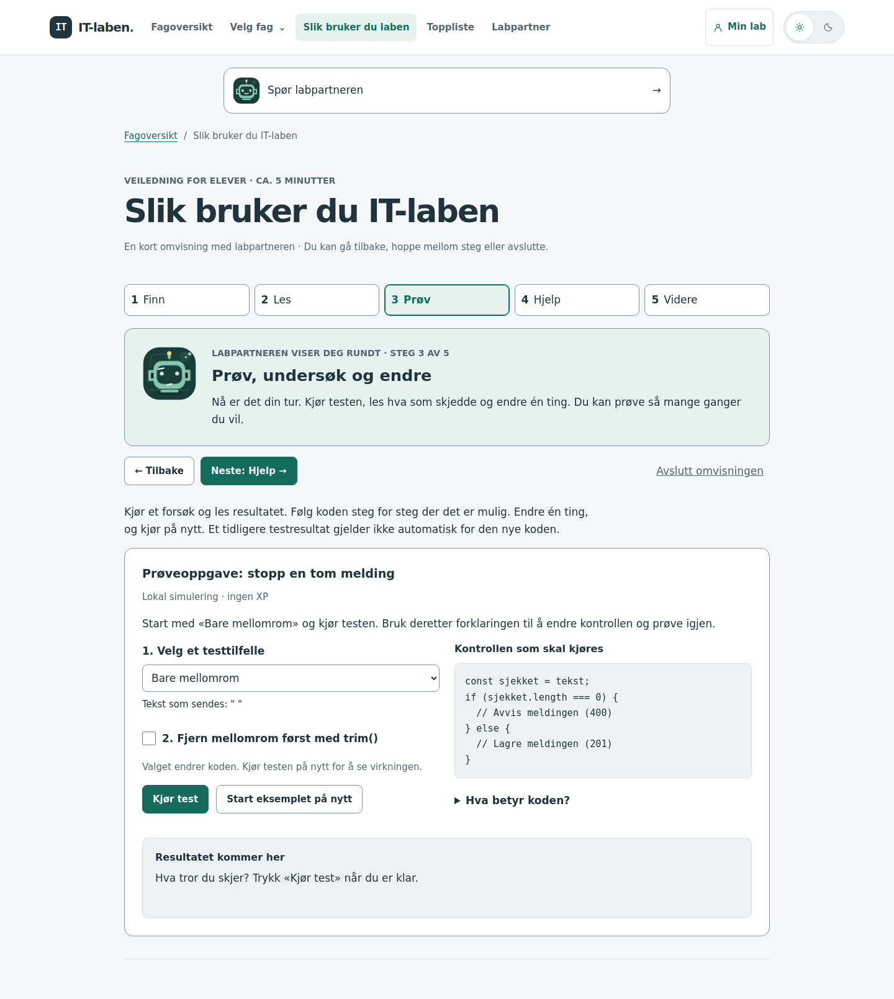
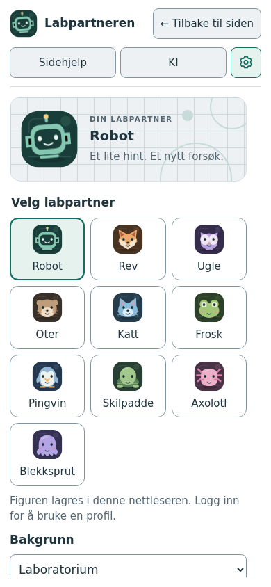

# Backend og elevens kom-i-gang-veiledning

**Nyeste videreutvikling, dev 31. oktober 2026:** [Samlet undervisningsforløp for Backend](backend-undervisning.md) beskriver hele modulen, forberedelser, nye læreropplegg og kontroll før bruk. Utprøvingen skjer i ordinær undervisning. [Validering fra øving til egen kode](backend-validering.md) beskriver første del av arbeidet nærmere.

28. oktober 2026. Brukerbestilt opprydding: ett Backend-forløp under Utvikling, et tannhjul for labpartnerens utseende og en egen tutorial på `/tutorial/`.

## Backend: mål og avgrensning

Backend samler eksisterende undervisning, øvinger og oppdrag. Rekkefølgen er dataflyt, lagring og validering, innlogging og tilgang, publisering og drift, deretter repetisjon og ekstra utfordring. Nattevakten beholder eksisterende tids- og vurderingsregler og er en ekstra utfordring. Øving 10 ligger i delen Publisering og drift, før repetisjonen. Øvingen beholder fagtilknytningen Driftsstøtte og eksisterende progresjon. Den tidligere selvstendige driftsmodulen og undervisningsopplegget «Fra kode til tjeneste» er fjernet etter brukerens ønske. Databaseinnhold forblir en egen modul.

Læreplan: [ITK02-01, Utvikling og Driftsstøtte](laereplan/ITK02-01.md). Lokale målreferanser med ordrett kompetansemål:

- **UTV-01:** «vurdere fordeler og ulemper ved ulike programmeringsspråk og velge og anvende relevante programmeringsspråk og algoritmer i eget arbeid». Modulen gir avgrenset øving i å lese, anvende og endre JavaScript-kode. Den dekker ikke sammenligning og valg av programmeringsspråk alene.
- **UTV-07:** «analysere digitale trusler, verdier og sårbarheter og utvikle applikasjoner med innebygget sikkerhet». Validering, session og eierskap lar eleven undersøke utvalgte sårbarheter og tiltak. Et komplett trusselbilde og en egen sikker applikasjon krever videre arbeid.
- **UTV-08:** «anvende relevant testmiljø og utføre testing tilpasset IT-løsningen som utvikles». Eleven velger normal- og feiltilfeller, sammenholder kode og data og prøver endringer på nytt. Simulatorene forbereder testing i elevens faktiske utviklingsmiljø.
- **DRS-06:** «planlegge og dokumentere arbeidsprosesser og IT-løsninger». Øving 10 lar eleven undersøke rekkefølgen ved publisering, omstart og gjenoppretting. Simuleringen er forberedelse; planlegging og dokumentasjon i et faktisk test-/driftsmiljø må inngå i lærerens videre oppfølging.

Forkunnskaper er JavaScript-variabler, objekter, lister og funksjoner. Arbeidet støtter lesing av kode, muntlig forklaring og systematisk problemløsing. JSON-fillagring er ikke en erstatning for kompetansemålene om databaser. Omorganiseringen endrer ikke oppgavenes respons, løsninger eller belønninger.

Lærerens videre oppfølging: La eleven bygge en tilsvarende rute for eksempel for visningsnavn i eget prosjekt. Be om begrunnede testtilfeller og en forklaring av hvor serveren avviser ugyldige data. Vurder både funksjonen og forklaringen; modulens progresjon er ikke dokumentert forståelse.

Etter Øving 10 kan eleven publisere egen backend i et avtalt testmiljø, kontrollere tjenesten etter omstart og dokumentere fremgangsmåte og testresultat. Be eleven forklare forskjellen på kildekode, frontendbygg og serverprosess, og hvilke data som bevares eller forsvinner ved omstart. Dette undersøker overføring til egen løsning med mindre støtte enn simuleringen.

## Tydeligere oppgaver og samlet støtte, 30. oktober 2026 (dev)

Brukerbestilt forbedring etter kildegjennomgang: Elevene trenger å se hva de skal gjøre ved arbeidsflaten, og flere parallelle pilotinnganger gjør valget unødvendig vanskelig. De fem hoveddelene og de eksisterende aktivitetene er beholdt. Målgruppe, forkunnskaper og kompetansemål UTV-01, UTV-07, UTV-08 og DRS-06 med ordlyd og avgrensning står ovenfor.

### Elevhandling, støtte og respons

Øving 5–10 bruker de samme tre undersøkelsesoppgavene som før, nå med korte valg øverst i simulatoren. Den valgte oppgaven viser en handlingsrettet overskrift, «Gjør dette» og «Se etter». Hint og forklaring er tilgjengelige i egne åpne/lukke-felt. En mindre intro og fjerningen av den separate oppgavelisten nederst begrenser gjentakelser. Det tidligere tomme venteområdet viser et kort kodeeksempel før første kjøring. Eksemplene er utdrag, ikke komplette serverfiler.

Fargejustering på dev: Både kodeeksemplet før kjøring og de klikkbare kodelinjene i øving 5–10 bruker nå `CodeTokens`, med samme farger og tekstoppdeling som `InteractiveCode` i chatrom. Nøkkelord, strenger, funksjoner, tall og kommentarer følger dermed den eksisterende kodevisningen. Komponenten er hentet ut av `InteractiveCode` og gjenbrukes begge steder. Koden rendres fortsatt som tekst, og linjevalg, forklaringer og progresjon er uendret. Diff er gjennomgått; samlet testing og visuell kontroll gjenstår før main.

| Del | Hva eleven gjør | Hva responsen viser | Overføring med mindre støtte |
| --- | --- | --- | --- |
| Meldingens reise | Sender med POST og henter med GET. | Hvor data ligger, hvilken kode som kjører og hva frontend viser. | Lag rutene i egen chat og prøv med to nettlesere. |
| Øving 5 | Følger lagring og sammenligner normal kjøring, skrivefeil og feil ved oppstart. | Fil, arbeidskopi, minne og HTTP-svar i hvert steg. | Lag varig lagring og kontroller både omstart og skrivefeil i testmiljøet. |
| Øving 6 | Endrer én meldings-ID, sletter ukjent ID og sammenligner før/etter GET. | Serverlisten kan være oppdatert før listen i nettleseren. | Bygg endring og sletting, og prøv to meldinger med lik tekst. |
| Øving 7 | Velger grensetester og sammenligner feil datatype, HTTP-feil og nettverksfeil. | Hvilken kontroll som stopper requesten, svar og uendret lagring. | Valider et visningsnavn og velg egne testtilfeller. |
| Øving 8–9 | Undersøker bruker, cookie, session og eierskap med ulike avsendere. | Hvilken identitet backend bruker og hvor tilgang avgjøres. | Bygg innlogging og beskyttede ruter; prøv også requests utenom knappene. |
| Redd chatten | Undersøker, reparerer og prøver både normal- og feiltilfeller. Kan forutsi om serverlisten vil endres. | Faktisk endring sammenlignes med forutsigelsen. Eksisterende tester vurderer funksjonen. | Bruk validering, session-eier og sletting på chatrom i egen app. |
| Øving 10 | Sammenligner kildekode, publiserte filer, prosess og VM-omstart. | Hva nettleseren faktisk får, og hvilke data som overlever. | Publiser og dokumenter egen app i avtalt testmiljø. |

Oppgavevalg i øving 5–10 endrer veiledningen, men beholder innstillinger og pågående kjøring. Eleven kan sammenligne og utforske fritt. Endring av simulatorens innstillinger tømmer fortsatt den gamle kjøringen. «Kjøringen er ferdig» vises nøytralt; det er ikke en godkjenning av oppgaven. Oppgavevalg, hint eller gjennomgåtte simulatorsteg registrerer ingen ny fullføring og gir ingen XP.

Fillagring og sessions merkes som innføring med en konkret overgang til øving 5 og 8. Chatrom får en tydelig fagtittel og en oppgave ved kontrollene for hvert forsøk. Moduloversikten har en sammenleggbar oppgave for eget prosjekt ved slutten av hver hoveddel (repetisjonsdelen før den valgfrie Nattevakten). Disse oppgavene legger ikke til nye progresjonskrav.

Redd chatten viser én hovedinngang. Tre hintnivåer, et kort kodeeksempel og en frivillig forutsigelse er integrert i de vanlige oppdragene. Forutsigelsen gjelder gjeldende oppdrag, request og kode; ved en kodeendring vises ikke sammenligningen for den gamle koden. Den sammenlignes med faktisk før/etter-liste og gir verken poeng, godkjenning eller trekk. Den detaljerte linjegjennomgangen beholdes for første oppdrag; de to andre beholder eksisterende blokkspor. De eksisterende funksjonstestene, løsningene og kravene er uendret.

Den separate pilotinngangen er flyttet til «Tidligere læringspilot» under hjelpen for egen chat. Den gamle siden, pilotpoengene og lagret arbeid i sessionStorage beholdes. Ingen pilotdata flyttes, slettes eller oppgraderes. Støtten samles uten å gjøre alle de seks pilotfasene obligatoriske eller å introdusere et nytt poengsystem.

### Design, kontekst og vurdering

Dette bruker [designgrunnlagets](webdesign-og-brukeropplevelse.md) prinsipper om hierarki, tydelige handlinger, konsistens og hjelp ved behov. Knapper har synlig valgt tilstand og `aria-pressed`; hovedvalg og hjelp har minst 44 piksler høye treffområder. Kompakt kodevisning beholder mindre linjeknapper. Oppgavevalg bryter over flere linjer, og oppsettet går til én kolonne på smal skjerm. Eksisterende tema- og fokusvariabler brukes. Dette beskriver implementasjonen; nettleserverifikasjon gjenstår.

[Pedagogikkgrunnlaget](pedagogisk-grunnlag.md) begrunner konkrete problemer, variasjon i elevhandling, kodeeksempel før utforsking og faglig respons som kan brukes i neste forsøk. Tre oppgaver og tre hintnivåer er lokale designvalg. Læreren undersøker forståelse gjennom elevens forklaring og en beslektet rute med egne testtilfeller. Hverken en forutsigelse, et åpnet hint, «gjennomgått» eller funksjonstester er alene dokumentasjon på forståelse.

Labpartneren i øving 5–10 får den valgte oppgaven via den eksisterende validerte oppgaveindeksen, også før eleven åpner en forklaring. Serveren gjenbruker instruksjon, observasjonsspørsmål, kodeeksempel og overføringsoppgave fra innholdsmetadata. Redd chattens servergrunnlag gjenbruker samme nye støtte. Ingen nye klientfelter eller rå fritekst er lagt til. Den frivillige forutsigelsen og valgt hintnivå i Redd chatten deles ikke med KI; partneren får fortsatt bare de allerede godkjente hendelsene og arbeidsstatusen. Ingen vurderingsfasit til fagsjekker deles.

### Bevaring av progresjon og kontroll før main

- Alle 14 registrerte backendaktiviteter, adresser, rekkefølger og deloppgave-ID-er er beholdt. Gamle modulaliaser og posisjoner er uendret.
- Ingen endring i `server/catalog.js`, `server/progress.js`, `checkpoints.js`, databaseversjon, XP-nøkler, opplåsing, lagrede løsningsformater eller klientens kø for usendte progresjonshendelser.
- `review`, `check-v2` og utfordringenes deloppgaver beholder samme vurderingsregler. Simulatorenes beregninger og Redd chattens startkode, kodeblokk-ID-er og evaluatorer er uendret.
- Pilotens side, sessionStorage-nøkkel `it-laben:redd-chatten-pilot:v1` og innholdet i lagringen er urørt. De nye støttevalgene er midlertidig visningstilstand i besøket.

Diff og kildekode er gjennomgått på dev. Ingen testsuite, Svelte-sjekk, bygg eller nettleserprøving er kjørt i denne leveransen, i tråd med dev-avtalen. Historiske kontroller nedenfor gjelder tidligere versjoner.

Før main: kjør samlet testsuite, Svelte-sjekk og produksjonsbygg, og prøv oppgavebytte, hjelp, gyldige/ugyldige forsøk og nytt forsøk i de endrede flytene. Prøv forutsigelse mot både endret og uendret serverliste, kode-/requestbytte, omstart av oppdrag og gamle resultater. Kontroller tastatur, fokus, smal skjerm, berøring, zoom og begge temaer. Kontroller kontoer med gjennomgåtte, beståtte og påbegynte aktiviteter, gjenlasting av lagrede løsninger, lærerens øvingsmodus, ventende innsendinger og en påbegynt pilotøkt. Sammenlign progresjon og XP før og etter oppgraderingen.

Utprøving med elever gjenstår: Kan eleven finne første handling uten muntlig navigasjonshjelp, bruke responsen til neste forsøk og anvende prinsippet i egen kode? Skill grensesnittproblemer fra faglige misforståelser. Ingen læringseffekt er dokumentert av denne endringen.

## Tutorial: mål og elevhandling

Målgruppe: elever som er nye i IT-laben. Det er først og fremst en verktøyveiledning. Den faglige miniprøven introduserer en avgrenset del av **UTV-08**, med ordlyden ovenfor, og krever ikke at eleven kan skrive koden selv. Målet er å finne en oppgave, forutsi et utfall, kjøre, lese respons, endre ett valg og teste på nytt.

Labpartneren følger eleven gjennom fem korte steg: finn en oppgave, les målet, prøv, bruk hjelp og gå videre. Eleven velger selv omvisningen og tempoet. «Neste», «Tilbake», direkte stegvalg og «Avslutt omvisningen» er alltid tilgjengelige. Ingen test eller avkryssing låser neste steg. Uten omvisningen vises alle delene som en vanlig oppslagsveiledning. Eksemplet er tydelig merket som lokal simulering og gir ingen XP eller lagret gjennomføring.

Den valgte labpartnerfiguren vises sammen med en kort forklaring i hvert steg. Steget ligger i `?tur=…`, slik at oppfrisking og nettleserens tilbakeknapp beholder plasseringen. Prøvevalgene beholdes mellom steg i samme besøk, men lagres ikke ved oppfrisking. Eleven kan starte igjen fra forsiden, veiledningen eller labpartnerens Sidehjelp. Omvisningen og prøveoppgaven krever verken KI, innlogging eller lokal lagring. Skolens nettside må være tilgjengelig; «uten KI» betyr ikke at nettstedet installeres for bruk uten nett.

| Elevhandling                       | Respons                                          | Nytt forsøk                                      |
| ---------------------------------- | ------------------------------------------------ | ------------------------------------------------ |
| Kjør med bare mellomrom, uten trim | Meldingen ble lagret; mellomrom telles som tegn  | Fjern mellomrom først og kjør igjen              |
| Endre kontroll uten å kjøre        | Siste resultat merkes som tidligere              | Kjør på nytt for å få oppdatert resultat         |
| Kjør med trim                      | Meldingen avvises fordi kontrollert tekst er tom | Prøv en vanlig melding med samme kontroll        |
| Kjør en vanlig melding             | Meldingen lagres                                 | Undersøk også feiltilfellet; én test er ikke nok |

Ny anvendelse: eleven forklarer hvordan et visningsnavn bør valideres og foreslår to tester, deretter bruker prinsippet i egen kode i lærerens videre opplegg. Et riktig simulatorresultat eller lest tutorial teller ikke som en vurdering av forståelse.

Labpartneren gjenbruker `studentGuide.js` som sidegrunnlag. Arbeidsstatusen inneholder bare en kjent steg-ID (eller `all` for oppslagsvisningen), kjent eksempel, trim-valg og tilsvarende valg fra siste kjøring. Serveren henter stegets tekst og rekonstruerer responsen. Den får ikke råtekst eller framstiller utestede endringer som kjørte tester. Eldre klienter uten steg-ID tolkes som `all`. Samtalene følger vanlig avbrudd, personvern og merking av gamle svar.

## Design og teknisk gjennomføring

Tannhjulet bruker en SVG, synlig valgt tilstand, tilgjengelig navn og forklarende tittel. Trykkflaten er minst 44 × 44 piksler. Figuren og innstillingene beholdes. Tutorialen arver hovedmenyen og har lenker fra den, forsiden og tilkoblingshjelpen. «Kom i gang» beholder sin rolle som hjelp til sikker tilkobling.

Omvisningen viser ett innholdssteg om gangen og bruker samme farger, typografi og figurer som resten av IT-laben. Den åpnes frivillig, uten automatisk avspilling eller et lag over hele nettstedet. Stegbytte flytter fokus til overskriften; avslutning returnerer til startknappen. Berøringsmål er minst 44 piksler, og figuren følger valget om redusert bevegelse. Hjelpesteget åpner den faktiske labpartneren, slik at eleven kan prøve tannhjulet. Dette følger grunnlagets prinsipper om tydelig plassering, begrenset informasjonsmengde og kontroll over egen fremdrift; akkurat fem steg er et lokalt designvalg.

Moduler vises først. «Finn enkeltoppgaver» samler direktelenkene og åpnes ved søk/typevalg. Modulens fem deler har egne overskrifter og snarveier. Dette er lokale valg etter designgrunnlagets hierarki, konsistens og forståelig respons, ikke forskningskrav om akkurat denne utformingen.

Se [modulbeskrivelsen](moduler.md) for migrasjon av publiseringsstatus og kompatible lenker. Ingen aktivitets-ID endres. Gamle moduladresser blir statiske videresendinger. Nye moduler får fortsatt status kommende.

## Kontroll og utprøving

Automatiske tester dekker feil/retting/normaltilfelle, gammelt testresultat, avvisning av råtekst og falske resultatfelt, moduldekning, gamle lenker og publiseringsmigrering. Eksisterende kontroller av konto, XP, progresjon og lærerroller kjøres også.

Pedagogisk utprøving gjenstår: La noen elever finne dagens oppgave uten instruksjon om bestemte knapper, bruke responsen i prøveforsøket og forklare overføringen til visningsnavn. Noter navigasjonsproblemer separat fra faglige misforståelser. Teknisk kontroll viser ikke læringseffekt.

### Kontroll av innlemmingen av publisering og drift

28. oktober 2026: Alle 200 automatiske tester består. `npm run check` gir ingen feil eller advarsler, og et rent `npm run build` fullfører med statisk publiseringsutdata. Den bygde gamle moduladressen videresender til Backend del 16. Testene kontrollerer også tilbakeveien fra Øving 10, de to gjenværende modulene, fjerning av opplegget og lærerveiledningen, og bevaring av elevprogresjon, XP og historiske publiseringsdata. Kommende Backend skjules i modulsøket; direkte enkeltøvinger følger den eksisterende navigasjonspolicyen.

Nettleserprøve av denne endringen er ikke utført: automatisk godkjenningskontroll avviste lokal nettleseroppstart, og den separate nettleseren blokkerte forhåndsvisningsadressen. Det gjenstår å prøve Backend → Øving 10 → tilbake, gammel moduladresse og læreroversikt med tastatur, berøring, smal skjerm, zoom og begge temaer. Svelte MCP var ikke tilgjengelig; offisiell Svelte-/SvelteKit-dokumentasjon og prosjektets kontroller ble brukt. Den historiske nettleserkontrollen nedenfor gjelder versjonen før denne endringen.

### Utført teknisk kontroll før innlemmingen av publisering og drift

- 199 automatiske tester bestått. Svelte-sjekk uten feil/advarsler og produksjonsbygg bestått.
- Automatiske kontrakttester dekker alle omvisningssteg, eldre klienter uten steg-ID og avvisning av ukjente steg eller innsendt stegtekst.
- Omvisningen: start, tastaturfokus, fem steg, direkte stegvalg, tilbake/fremover i nettleseren, oppfrisking, avslutning og omstart. Prøveoppgaven er kontrollert med feiltilfelle, retting, vanlig melding og gammelt testresultat, også etter stegbytte. Ingen API-skriving ble utløst av omvisningen.
- Backend → aktivitet → tilbake og gammel moduladresse er prøvd med ekte lokal API og midlertidig testdatabase. Utvikling viser Backend og Databaser, med drift i eget fag.
- Omvisning, fagoversikt og Backend: 30 kombinasjoner av 1920, 1440, 768, 390 og 320 CSS-piksler og begge temaer, uten horisontal sideoverflyt. De tre sidene er også prøvd ved 320 piksler med 200 % tekst og økt tekstavstand. Knappen og innholdstypene på modulsiden bryter nå lange tekster ved behov.
- Mobil: faktisk labpartner åpnet fra hjelpesteget, tannhjul med berøring, lukking med Escape og fokus tilbake til åpneren. Omstart fra Sidehjelp lukker dialogen og frigjør siden. Ingen registrerte JavaScript-feil. Axe fant ingen relevante A/AA-avvik i de tre undersøkte sidevisningene; dette er ingen full tilgjengelighetsrevisjon.
- Utilgjengelig API, blokkert lokal lagring, ukjent steg og redusert bevegelse er prøvd. Valgt figur følger omvisningen, også uten innlogging.
- Svelte MCP var ikke tilgjengelig. Offisiell Svelte-/SvelteKit-dokumentasjon, prosjektets kontroller og Playwright ble brukt.

Ollamas faktiske svar på tutorialen og elevenes bruk er ikke prøvd. Kontrakt og serverbygget kontekst er testet uten den lokale modellen.

## Frivillig spørsmål om tydelighet, 31. oktober 2026 (dev)

Øving 5, 8 og 10 kan tilby ett kort spørsmål ved slutten av en simulert kjøring eller etter intern navigasjon bort fra et påbegynt forsøk. Eleven velger Ja, Delvis eller Nei til «Var det tydelig hva du skulle gjøre?», kan hoppe over og kan slå av spørsmålene. Svaret har ingen kobling til vurdering eller XP. Se [elevtilbakemeldinger](elevtilbakemeldinger.md) for forskningsgrunnlag, hyppighetsgrenser, sidekontekst, lagring, adminvisning og gjenstående kontroller før main.

