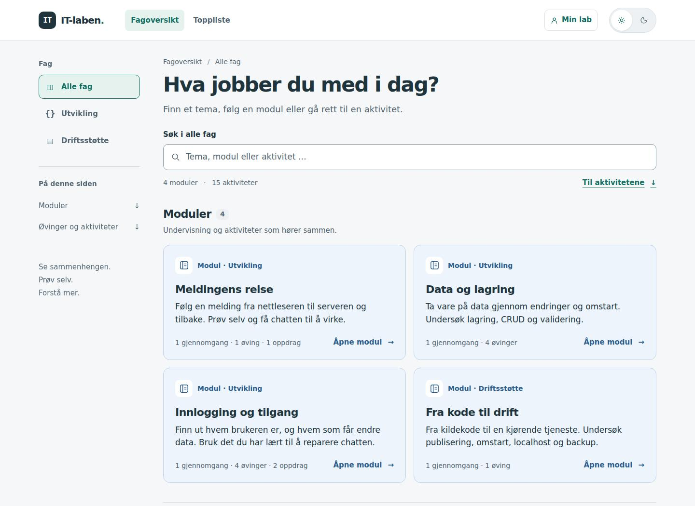
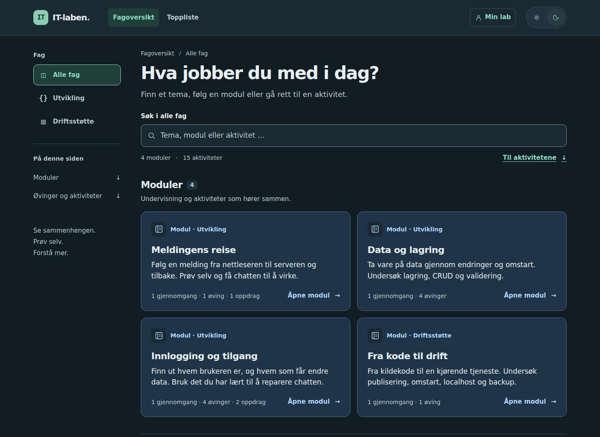
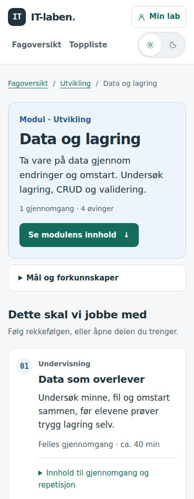

# Designvurdering og nytt utkast for IT-laben

**Dato:** 27. oktober 2026 · **Status:** Første utkast på `dev`, til utprøving.

Navigasjonen er senere videreført til alle sider, også lærerpanel og Min lab. Se [felles navigasjon og design](felles-navigasjon.md) for gjeldende oppsett og nye kontroller. Skjermbildene og målingene nedenfor dokumenterer første utkast.

## Vurderingen

IT-laben har et godt utgangspunkt: innholdet kan åpnes uten å følge et låst forløp, moduler skiller seg fra enkeltaktiviteter, og eleven får forklaringer, hint og nye forsøk. Begge fargetemaene bruker felles variabler. Dette videreføres.

Den største utfordringen i oversikten er å finne fram når innholdsmengden øker. I forrige versjon måtte brukeren forbi alle modulene før søket ble synlig. Søket fant heller ikke selve modulene. På mobil kom mål, ressurser og støttetekst foran modulens arbeidsrekkefølge. Når eleven åpnet en øving fra modulen, manglet en tydelig lenke tilbake til den samme modulen.

Det nye utkastet prioriterer derfor **å finne innhold, forstå hvor man er, og komme videre**. Endringene i utseende støtter disse oppgavene. Dette er en faglig vurdering basert på kode og nettlesergjennomgang, ikke en brukertest med elever eller en dokumentert læringseffekt.

### Grunnlag og omfang

Vurderingen bruker [webdesign- og brukeropplevelsesgrunnlaget](webdesign-og-brukeropplevelse.md) og [det pedagogiske grunnlaget](pedagogisk-grunnlag.md). U1–U8 nedenfor viser til kildegjennomgangen i designgrunnlaget. Prinsippene om faglig arbeid, respons og tydelig progresjon fra pedagogikkgrunnlaget gjelder fortsatt.

Forsiden, modulen «Data og lagring», øving 5 og backend-quizen er undersøkt på desktop og mobil i begge temaer. Modulnavigasjonen er også prøvd gjennom de eldre forklaringssidene og spillene som modulene lenker til. Dette er første designutkast for inngangen til innholdet og de felles stilene; det er ikke en full gjennomgang av alle tilstander i alle spill, innloggingen eller lærer- og administratorverktøyene.

## Funn og valg i utkastet

| Prioritet | Konkret observasjon i forrige versjon | Endring i utkastet | Begrunnelse |
| --- | --- | --- | --- |
| Høy | Søket lå under alle modulene og søkte bare i enkeltaktivitetene. | Synlig søk øverst. Søker i moduler og aktiviteter innen valgt fag, også via modulens offentlige innhold. | U1 og U6: synlige valg og forståelig struktur. |
| Høy | En aktivitet åpnet fra en modul hadde ingen egen tilbakevei til modulen. | Modulens lenker tar med tilhørigheten. En tydelig tilbakeknapp vises på tilhørende aktivitetsider, også etter oppfrisking. | U1: orientering, tilbakevei og brukerens styring. |
| Middels | Mål, forkunnskaper og ekstraressurser skjøv arbeidsrekkefølgen langt ned på mobil. CSS-rekkefølgen var dessuten ulik dokumentrekkefølgen. | Mål og forkunnskaper kan åpnes rett under introduksjonen. Arbeidsrekkefølgen kommer før ekstraressurser på mobil. | U6 og pedagogikkens del 3 og 5: støtte nær arbeidet, med tydelig hovedinnhold. |
| Middels | Kort gjentok format, underkategori, temaer og type med omtrent lik visuell vekt. | Blå modulkort med fag, tittel, kort forklaring og omfang. Hvite aktivitetskort med tydelig tittel, oppgavetype og en kort beskrivelse. | U3 og U6: et tydeligere visuelt hierarki. De konkrete fargene og kortformene er lokale valg. |
| Middels | Fagvalg og «Alle fag» var plassert hver for seg. Sidene hadde flere varianter av toppmenyen. | Samlet fagmeny i venstrekanten på desktop og over innholdet på mobil. Felles toppmeny på forsiden, modulsidene, øving 5–10 og quizen. | U1 og U6: gjenkjennelig navigasjon og konsistente valg. |
| Middels | Felles tekststørrelser var 16 px for brødtekst, 14 px for liten tekst og 13 px for metadata ved standard nettleserinnstilling. | Startverdiene er 17, 15 og 14 px, angitt i `rem`. Vanlig kodestørrelse øker fra 15 til 16 px. Oppgaveintroduksjoner kan være større. | U2 og U7: lesbarhet og skalering. Verdiene er utprøvingsvalg, ikke tall forskningen krever. |
| Middels | Kodeutdraget i quizen krevde vannrett rulling på smal skjerm, uten en egen tabulatorstopp. | Kodeområdet kan få synlig tastaturfokus og rulles med piltaster. | U7: tastaturbetjening. Avdekket og rettet under kontroll av utkastet. |

### Hvordan det ser ut

Forsiden har nøytrale flater, mørk hovedtekst og grønn markering for valg og handlinger. Blåtonen identifiserer moduler, sammen med tekstmerket «Modul». Farge brukes ikke alene for å formidle type eller status. Mørkt tema bruker de samme rollene med egne farger.

### Navigasjon og arbeidsflyt

- Fagvalget gjelder både moduler og enkeltaktiviteter. Moduler står fortsatt først, og øvinger, oppdrag og spill er tilgjengelige lenger ned.
- Søket gjelder begge oversiktene. Filteret under «Øvinger og aktiviteter» avgrenser bare aktivitetstypen. Dermed skjules ikke relevante moduler når man velger «Oppdrag og spill».
- Søket har synlig etikett, resultatantall og en vei videre ved null treff. Nullstilling beholder valgt fag og flytter fokus tilbake til søkefeltet.
- Fag, søk og aktivitetstype følger fortsatt nettadressen og fungerer ved oppfrisking og tilbakeknapp. Gamle lenker til `#spill` og `#ovingene` er bevart.
- Fra en modul åpnes for eksempel `/oving-5/?modul=data-og-lagring`. Tilbakeknappen går til øvingens punkt i modulen. En egen aktivitet prioriteres som returpunkt dersom samme side også brukes i felles gjennomgang.
- Tilhørigheten vises bare når modulen faktisk lenker til siden. Ugyldig eller feil modul i adressen ignoreres. Ved overgang til en øving utenfor modulen fjernes tilhørigheten.
- Mål og forkunnskaper er fortsatt tilgjengelige nær modulens introduksjon. Elevene kan åpne hvilken del de trenger. Støtteinnhold skal ikke kreve fullføring av tidligere deler.

Dette endrer ikke oppgaver, fasit, XP, vurderingsregler eller elevdata. «Gjennomgått», «Bestått» og «Påbegynt» beholder sine betydninger. Ingen ny modulstatus utledes fra at eleven besøker en side.

## Kontroll og praktiske begrensninger

### Plassering før og etter

Målt som avstand fra sidens topp til elementets topp, i CSS-piksler, som utlogget bruker med standard tekststørrelse og lyst tema. Dette beskriver plasseringen, ikke hvor raskt en elev finner fram.

| Element og skjermbredde | Før | Utkast |
| --- | ---: | ---: |
| Søk på forsiden, 1440 px | 1219 | 299 |
| Søk på forsiden, 390 px | 1990 | 446 |
| Første innholdspunkt i «Data og lagring», 390 px | 1151 | 697 |

På mobil kommer første modulkort noe lenger ned enn før, fordi søket nå ligger foran modulene. Dette er en avveining: søket og lenken direkte til aktivitetene er lettere tilgjengelige, mens modullisten trenger litt mer rulling. Dette må prøves med elever, særlig dem som alltid går til samme modul.

### Gjennomførte tekniske kontroller

- `npm test`: 155 tester bestått, inkludert åtte nye tester av søk og modultilhørighet.
- `npm run check`: 0 feil og 0 advarsler. Kodeutdragets tilsiktede tabulatorstopp har en avgrenset, kommentert Svelte-unntaksregel; rulling kontrolleres i nettleseren.
- `npm run build`: statisk produksjonsbygg bestått.
- Hele backend-quizen med 20 spørsmål er kontrollert med feil og riktige svar, hint, tastatur, nytt forsøk, oppsummering og nullstilling.
- Nettleser: søk i begge katalogene, fag-/typefilter, null treff, nullstilling/fokus, URL, oppfrisking, tilbakeknapp, gamle ankre og modulens tilbakevei.
- Elev-/lærervisning og progresjon er prøvd med simulerte API-svar. Ingen skriving av elevprogresjon ble utløst av navigasjon. Presentasjonsvisningen skjuler fortsatt den vanlige toppmenyen.
- Øving 5 er prøvd med vellykket lagring (201), lagringsfeil (500), stegvis kjøring og ny start. Modulnavigasjon er også prøvd med emulert berøring.
- Desktop og mobil i begge temaer, tastatur, 320 px visningsbredde, 200 % tekstforstørring og overstyrt tekstavstand er kontrollert på de fire hovedsidene.
- Automatiske tilgjengelighetskontroller med axe-core på de fire sidene, i to temaer og to skjermbredder: ingen rapporterte brudd i de 16 kontrollerte starttilstandene etter retting av kodeområdets fokus.

En ekstra kontroll av de eldre sidene fant også at pilotens toppmeny gikk utenfor 320 px bredde. Den får nå bryte over flere linjer.

Automatiske kontroller dekker bare deler av tilgjengeligheten. Dette er ikke en full WCAG-samsvarsvurdering. Bruk med faktiske skjermlesere, ulike elevbehov og klasseromsutstyr gjenstår.

## Hva vi bør prøve med elever

Gi 3–5 elever oppgavene uten å peke ut knapper eller menyer:

1. Finn modulen som handler om data som overlever en omstart.
2. Åpne øving 5 fra modulen. Gå deretter tilbake til modulen.
3. Finn et spill om innlogging eller tilgang uten å gå gjennom en hel modul.
4. Finn repetisjonen av backend-øving 1–10.
5. Finn ut hva du bør kunne før du begynner på «Data og lagring».

Noter hvor eleven leter, om hen løser oppgaven uten hjelp, og hva hen forventet skulle skje. Se spesielt etter om forskjellen mellom moduler og aktiviteter er forståelig, om målene blir funnet bak «Mål og forkunnskaper», og om fagmenyen fungerer like godt på mobil. Spør også om tekst og kode er behagelige å lese. Hold faglige misforståelser atskilt fra navigasjonsproblemer.

Et lite utvalg kan avdekke problemer, men dokumenterer ikke representativitet eller læringseffekt. Før en eventuell bredere innføring bør vi også undersøke de lengre aktivitetsflatene, fagsjekker, innlogging og lærerens arbeidsflyt. Ved første utkast hadde de eldre sidene fortsatt egne toppmenyer. Disse er senere erstattet med felles navigasjon; se oppfølgingsnotatet over.

## Ved videre arbeid

Hovedmenyen arves nå fra rotlayouten. Bruk `ModuleCard.svelte`, `ActivityCard.svelte`, `ModuleContext.svelte` og felles variabler i `theme.css` når tilsvarende utforming utvides. `catalogueSearch.js` holder søk i offentlig innhold samlet. `moduleNavigation.js` avgrenser hvilke lenker som kan ha modultilhørighet. Unngå nye lokale fargepaletter eller parallelle varianter av de samme kontrollene uten en konkret begrunnelse.

Endringer i oppgavens læringsmål, elevhandlinger eller faglige respons må fortsatt vurderes etter pedagogikkgrunnlaget. Dette utkastet organiserer og presenterer det eksisterende innholdet.
