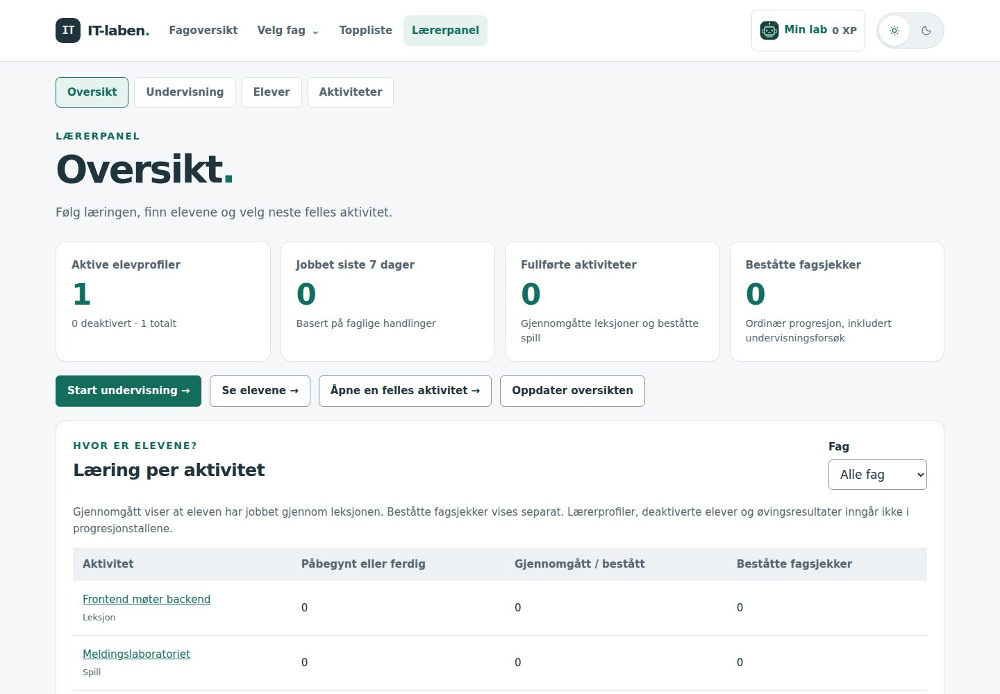
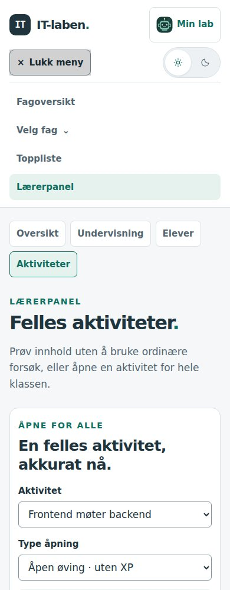

# Felles navigasjon og design

**Dato:** 27. oktober 2026 · **Status:** Utkast på `dev`, til utprøving.

Dette viderefører [det første designutkastet](designvurdering-og-utkast.md) til hele nettstedets navigasjon, inkludert lærerpanel, Min lab, toppliste, hjelpesiden og eldre aktiviteter.

## Vurdering og endring

Den største gjenværende ulikheten var at hver side kunne definere sin egen toppmeny. Flere sider manglet valg som fantes på forsiden, lærerlenken hadde ulik plassering og betydning, og «Felles aktiviteter» brukte en annen layout enn resten av lærerpanelet. Brukeren måtte derfor lete etter kjente valg på nytt ved navigasjon.

| Område | Ny løsning |
| --- | --- |
| Hovednavigasjon | Én `LabHeader` i SvelteKits rotlayout. Fagoversikt, fagvalg, toppliste, Min lab, lydknapp og temavelger har samme plassering på alle vanlige sider. Lærerpanel vises for lærer og administrator. |
| Fag | «Velg fag» gir tilgang til fagene fra alle sider. Faglisten på forsiden er fortsatt et lokalt filter for katalogen. Valg gjennom hovedmenyen oppdaterer også en allerede åpen forside. |
| Mobil | En navngitt menyknapp viser og skjuler navigasjonen. Menyen lukkes ved navigasjon og kan lukkes med Escape. XP-tallet skjules i den kompakte kontolenken; det er fortsatt tilgjengelig i Min lab. |
| Hvor man er | Hovedmenyen, Min lab og lærerfanene markerer gjeldende side eller område med tekstfarge, bakgrunn og `aria-current`. |
| Lærerpanel | Oversikt, Undervisning, Elever og Felles aktiviteter bruker samme `TeacherShell`, sidebredde, kort, kontrollstiler og tekstskala. Administratorkontrollene beholder eksisterende rollekrav. |
| Innholdsflate | Sidebredde og yttermarger følger felles variabler. Læreroversiktens statistikkort stables på smal mobil, slik at lange ord ikke skyver siden utenfor skjermen. |
| Lokale valg | Stegmenyer, modulens tilbakevei og faglige kontroller beholdes i innholdet. Tidligere lenker til beslektede aktiviteter i toppmenyer er samlet i `PageLinks` nederst i de aktuelle sidene. |
| Tastatur og feilside | En felles hopplenke fører til sidens hovedinnhold. Den nye feilsiden arver også hovedmenyen og gir en vei tilbake til fagoversikten. |

Presentasjonsvisning er et bevisst unntak: læreren får presentasjonskontrollene i stedet for hovedmenyen. «Avslutt visning» går tilbake til læreropplegget og gjenoppretter vanlig navigasjon.

Dette følger særlig U1 og U6 i [designgrunnlaget](webdesign-og-brukeropplevelse.md): gjenkjennelig navigasjon, forståelig plassering og tydelige tilbakeveier. Utforming og plassering er prosjektvalg. [Pedagogikkgrunnlaget](pedagogisk-grunnlag.md) videreføres; oppgaver, vurdering, progresjon og XP-regler er ikke endret.

## Forhåndsvisning

Skjermbildene bruker oppdiktede testprofiler og simulerte API-svar.

## Bruk av Svelte-dokumentasjonen

Svelte MCP var ikke tilgjengelig i denne økten. `list-sections`, `get-documentation` og `svelte-autofixer` er derfor ikke kjørt. I tråd med `AGENTS.md` ble den offisielle dokumentasjonen brukt direkte:

- [SvelteKit routing og layouts](https://svelte.dev/docs/kit/routing#layout): legg navigasjon som gjelder flere sider i layouten, med `children` og `{@render}` for sideinnholdet.
- [SvelteKit `$app/state`](https://svelte.dev/docs/kit/$app-state): les gjeldende rute reaktivt for aktiv menymarkering.
- [Tilgjengelighet i SvelteKit](https://svelte.dev/docs/kit/accessibility): beskrivende sidetitler, rutemeldinger og fokus ved navigasjon.
- [Svelte `$props`](https://svelte.dev/docs/svelte/$props) og [`{@render}`](https://svelte.dev/docs/svelte/@render): felles komponenter med tydelige grensesnitt.

Prosjektets Svelte-kompilator, `svelte-check`, produksjonsbygg og nettleserkontroller er brukt til kontroll. De erstatter ikke en kjøring av MCP-autofikseren.

## Utført kontroll

- **155 eksisterende tester bestod.** `npm run check` ga null feil og null advarsler; `npm run build` bygde de statiske sidene.
- Alle **28 publiserte sider** ble åpnet som gjest ved 1440 piksler i lyst tema og 320 piksler i mørkt tema. Hver hadde én felles toppmeny, én hovedinnholdsflate og en gyldig hopplenke. Ingen horisontal sideoverflyt ble registrert i disse tilstandene.
- Forside, fire lærersider, Min lab og toppliste ble i tillegg kontrollert med lærerprofil ved 320/390/1440 piksler i begge temaer. Lærerveiledning og elevdetaljer ble prøvd separat. Totalt ble **88 sidetilstander** målt.
- Axe-core fant ingen avvik i hovedmenyen i disse kontrollene. For de 32 ekstra tilstandene med lærerprofil ble hele siden kontrollert med utvalgte WCAG A/AA-regler, også uten påviste avvik.
- Navigasjon gjennom lærerfaner og elevdetaljer, fagbytte på samme side, nettleserens tilbakeknapp, tastatur, Escape, fokus, hopplenke og emulert berøring ble prøvd.
- Menyene ble prøvd som gjest, elev, lærer og administrator. Administratordialogen ble åpnet og avbrutt. Feil ved henting av læreroversikten og nytt forsøk ble prøvd med simulerte API-svar. Ingen skrivekall ble utført i disse navigasjonskontrollene.
- Presentasjon ble startet fra lærerveiledningen og avsluttet tilbake til samme opplegg. En ukjent rute viste feilsiden med felles navigasjon.
- Seks sentrale sider ble prøvd med 200 % tekststørrelse og overstyrt tekstavstand uten horisontal sideoverflyt. Utvalgte skjermbilder ble gjennomgått visuelt. Ingen JavaScript-feil eller hydreringsavvik ble registrert i de prøvde flytene.

Dette er teknisk kontroll, ikke full WCAG-samsvarsvurdering, en test med en virkelig skjermleser eller en brukertest med elever og lærere. Rolle- og datavisning ble prøvd med testdata, ikke med elevdata på produksjonsserveren. Alle interne spilltilstander og lagringsoperasjoner er ikke gjennomgått på nytt. Spillene beholder faglige arbeidsflater og egne uttrykk, blant annet Nattevaktens mørke operasjonsrom; den globale menyen følger nettstedets fargetema også der.

## Videre arbeid

Nye sider arver hovedmenyen fra rotlayouten og skal ikke sette inn `LabHeader` selv. Lærersider bruker `TeacherShell`. Gi én `main` per side `id="hovedinnhold"` og `tabindex="-1"`. Bruk `PageLinks` for tilsvarende relaterte lenker og behold lokale arbeidsmenyer der oppgaven krever dem. Dette er også lagt inn i [AGENTS.md](../AGENTS.md).

Prøv med elever og lærere om de finner tilbake til et fag fra en aktivitet, åpner lærerpanel fra Min lab og kommer tilbake fra en presentasjon. Se spesielt etter om «Velg fag», «Fagoversikt» og den lokale faglisten har forståelige roller, og om mobilmenyen er lett å oppdage. Faktisk bruk må avgjøre om disse valgene trenger justering.

## Felles lydknapp

**Dev-justering 29. oktober 2026.** Høyttaleren i `LabHeader` styrer lyd for hele IT-laben: belønninger, VLAN-kontroll og Nattevakten. Den står ved temavelgeren, utenfor den sammenleggbare mobilmenyen. Lokale lydvalg i øvingene er fjernet. Innstillinger beholder lydstyrke, en prøveknapp og en lenke til høyttaleren.

Dette er et prosjektvalg etter designgrunnlagets U1/U6 og del 4.1–4.3: en innstilling med samme virkning får samme plassering på tvers av sider, mens arbeidsflaten beholder de faglige handlingene. Høyttaler med bølger/kryss, forklarende tittel og `aria-pressed` formidler tilstanden uten å være avhengig av farge. Native knapp, 44 × 44 px trykkflate, synlig tastaturfokus og felles temavariabler viderefører menyens mønster. Ingen ekstra innstillingsmeny kreves for av/på.

`labPreferences` eier av/på og volum i `it-laben-experience-v1`. Lyd er på som standard etter brukerens avklaring. En tidligere lagret `sound: false` beholdes. Det gamle VLAN-valget migreres én gang; hvis enten VLAN eller felles lyd var slått av, beholdes dempingen. Den gamle nøkkelen fjernes først etter vellykket lagring. Sperret lagring tillater fortsatt endringer i den åpne fanen. Andre åpne faner følger endringer via `storage`.

Innstillingene leses etter montering; knappen er deaktivert til dette er ferdig. Innlasting og navigasjon starter ingen lyd alene. Avspillere registreres mens aktiviteten er montert. Demping, volumendring og skjult fane stopper pågående/ventende lyder. Nattevaktens aktive lydbilde kan fortsette med valgt volum etter en brukerhandling; gamle kontrollresultater spilles ikke av på nytt ved påslag. Avspillere avregistreres og lukkes ved navigasjon. Resultat, feilmeldinger og progresjon fungerer uavhengig av lyd.

**Kontrollstatus 29. oktober:** Regresjonstestene for lagrede valg, migrering, felles demping og ventende lydstart bestod. Svelte-sjekk, bygg og nettleserprøving er gjennomført før merge; se [samlet publiseringskontroll](publisering-2026-10-29.md). Tannhjulet bevarer også fagfilteret fra Min lab. Elevutprøving skal undersøke om lydknappen blir funnet og forstått.
