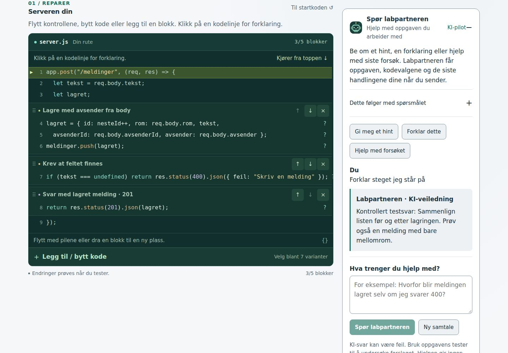
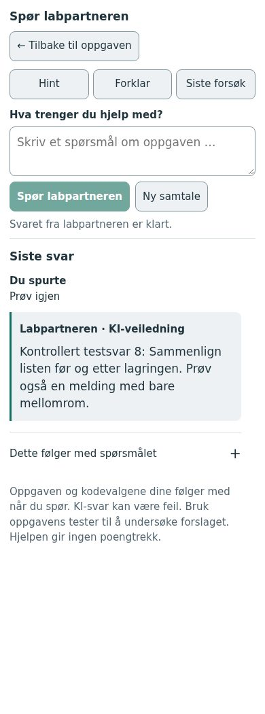

# Labpartner med sidehjelp og lokal KI

Labpartneren er tilgjengelig på elevsidene. Lærer- og administratorsider er unntatt. Den detaljerte konteksten er utvidet til øvingene og aktivitetene, med felles støtte for videre innhold. Se [kontekstsystemet og oppskriften for nye sider](labpartner-kontekst.md).

## Sidehjelp, KI og utseende

**Labpartner** i hovedmenyen og **Spør labpartneren** ved innholdet åpner samme panel. Hjelpen er valgfri, og ingen modellforespørsel sendes ved navigering. Hjelpens tre valg er:

- **Sidehjelp:** fast, offentlig veiledning som virker uten backend og innlogging. Sidens tema og korte forslag til neste handling gjenbrukes fra innholdskatalogen, modulmålene og øvingenes introduksjoner og hint. **Et annet tips** lar eleven undersøke flere råd. Det fremgår at disse rådene ikke er KI-genererte eller basert på elevens forsøk.
- **KI:** krever innlogging og konfigurert KI i IT-labens backend. Panelet undersøker konfigurasjonen ved åpning, og velger KI når den er tilgjengelig, med mindre eleven allerede har valgt en annen visning. **Prøv KI igjen** undersøker på nytt. En konfigurert modell kan fortsatt være utilgjengelig; et mislykket spørsmål beholdes, og Sidehjelp er fortsatt tilgjengelig. Statusruten er ingen Ollama-helsesjekk.
- **Tannhjul (Utseende og innstillinger):** ti figurer, tre bakgrunner og valg av animasjoner. Se [avatarer og lagring](avatarer-og-trygg-lagring.md).

På elevsidene brukes `page-help` versjon 2 med kjent side-ID, eventuell validert modul og en avgrenset arbeidsstatus. Backend henter faglig grunnlag og kode fra IT-labens egne kilder. Nye øvingsark i felleskomponenten får koblingen automatisk. Se [delingsoversikten](labpartner-kontekst.md#hva-sidene-deler) for felter og begrensninger. Lærer-ID-er avvises også direkte i API-et.

Panelet har én figur i toppen, som vokser ved åpning. Sidehjelpen viser sidetittel og ett tips. «Mer hjelp» samler sideforklaring, hjelp om verktøyene og lenken «Vis meg rundt».

Panelet viser hva som følger med spørsmålet. Ingen fagsjekkspørsmål, Nattevakt-scenario eller vurderingsfasit hentes inn. Modellen kan forklare begreper og foreslå en undersøkelse, men skal ikke godkjenne arbeid eller gi XP. KI-generert veiledning må fortsatt prøves faglig med den lokale modellen; en systeminstruksjon garanterer ikke gode svar.

Samtalen beholdes ved lukking og skjermbreddebytte, men tømmes ved bytte av sidegrunnlag, profil eller øvingskontekst. Pågående spørsmål avbrytes ved slikt bytte. Ukjente ruter får en generell navigasjonshjelp; bare kjente fagfiltre påvirker sidegrunnlaget. Ingen samtale lagres permanent. Presentasjonsvisningen beholder fraværet av elevverktøy.

Målet er at eleven finner et relevant sted å starte, gjør ett begrunnet forsøk og bruker responsen til å undersøke videre. Læreren kan be eleven forklare årsaken og prøve en beslektet oppgave med mindre støtte. Verken bruk av hjelp, avatarreaksjoner eller beståtte programtester dokumenterer læring alene. Øvrige aktiviteter har ingen ny vurderingslogikk.

## Elevens bruk i Redd chatten

Åpne **Spør labpartneren** ved kodearbeidet eller **Spør om oppgaven** i avatarens kort. KI krever innlogging; Sidehjelp og Utseende virker også for gjester. Velg **Gi meg et hint**, **Forklar dette**, **Hjelp med forsøket**, eller skriv et eget spørsmål. Vanlige hint og kodelinjeforklaringer virker også når KI-tjenesten er avslått eller utilgjengelig.

På skjermer fra 1800 CSS-piksler har labpartneren en egen venstrespalte med plass til lesbar KI-veiledning. På vanlige skjermer står hjelpen under testområdet, med snarveien **Til testknappene** over svarene. Avatarens skiftende respons ligger under KI-panelet slik at den heller ikke flytter skrivefeltet. På mobil (inntil 600 CSS-piksler) åpner **Spør labpartneren** en egen dialog; **Tilbake til siden** eller Escape lukker den og gjenoppretter fokus og arbeidsposisjon. Utkast, samtale og en pågående forespørsel beholdes ved lukking og endring av skjermbredde.

Skrivefeltet og hurtigvalgene står over svarområdet. Nyeste spørsmål og svar vises først, mens **Tidligere svar** er lukket som standard. Bare svarområdet ruller ved vanlig skjermstørrelse; lange svar øker ikke panelets høyde. På svært lave skjermer får mobilvisningen rulle samlet slik at kontrollene forblir tilgjengelige. Leser eleven eldre innhold, beholdes leseposisjonen og **Nytt svar klart** lar eleven velge når det nye svaret skal vises. Modellen får fremdeles eventuell samtalehistorikk i kronologisk rekkefølge.

Dette er lokale designvalg etter brukerens utprøving: svar og skrivefelt ble skjøvet ned, og KI-panelet fortrengte testknappene. Endringen følger designgrunnlagets punkt 4.3 om stabil responsplass og pedagogikkens krav om tilgjengelig støtte som eleven kan bruke i neste forsøk. Testkontrollene ligger uavhengig av samtalelengden. Varsling av svar flytter ikke tastaturfokus eller ruller hele siden.

**Dette følger med spørsmålet** viser oppdrag, valgt testsituasjon, kode, testens aktualitet og de siste handlingene. Ingen modellforespørsel sendes før eleven spør. Panelet undersøker bare om piloten er konfigurert når det åpnes.

Et svar merkes som tidligere når kode, prøving eller valgt steg endres. Eleven kan avbryte forespørselen eller starte en ny samtale. Spørsmålet beholdes ved feil og avbrudd. Samtalen ligger i minnet i fanen, viser de siste fire svarene og tømmes ved omlasting, navigering bort, bytte av oppdrag, profil eller øvingskontekst. Inntil to tidligere spørsmål og svar fra **samme oppgavetilstand** følger med en oppfølging. Gamle svar om annen kode brukes ikke som gjeldende kontekst.

Svar vises som tekst, også hvis modellen skriver HTML. Piloten gir veiledning uten å skrive kode, utføre kommandoer, registrere forsøk eller tildele XP. Oppgavens eksisterende tester og fagsjekker beholder ansvaret for godkjenning og poeng.

Skjermbildene viser en kontrollert testtjeneste, ikke svar fra den lokale KI-modellen.





## Faglig hensikt og utprøving

Målgruppen er Vg2 IT med kjennskap til `if`, lister, `req.body` og HTTP-svar. Eleven skal kunne knytte kode og inndata til endringer i data og resultat, og bruke veiledningen til å velge et nytt forsøk. Tekstoppdraget undersøker validering før lagring; avsenderoppdraget undersøker serverens session; sletteoppdraget undersøker tilgang og eierskap.

Veilederen følger [det pedagogiske grunnlaget](pedagogisk-grunnlag.md): korte, anvendelige svar, konkretisering ved behov og elevens styring over hjelpen. Ingen obligatorisk spørsmålsrekke eller poengtrekk ved hjelp. Responsen skiller hva forsøket viste fra en mulig forklaring og neste handling. Et åpnet hint eller bestått test dokumenterer ikke forståelse.

Læreren bør først prøve kjente feil, utestede kodeendringer og riktige løsninger med den valgte modellen. Prøv deretter med 3–5 elever: Får eleven brukt rådet? Stemmer forklaringen med det synlige steget? Kan eleven forklare årsaken? Som ny anvendelse kan eleven overføre valideringsprinsippet til en romrute i eget prosjekt med mindre støtte. Dette følger [aktivitetsmalen](aktivitetsmal.md); brukertesting og dokumentasjon av læringseffekt er ikke gjennomført.

## Slik settes konteksten sammen

| Del               | Kilde og behandling                                                                                                                                            |
| ----------------- | -------------------------------------------------------------------------------------------------------------------------------------------------------------- |
| Veilederens rolle | Fast instruksjon i `server/lab-partner/contexts/redd-chatten.js`.                                                                                              |
| Faglig grunnlag   | Mål, krav, hint og faglig oppsummering gjenbrukes fra oppgavemodellen. Egne veiledningsråd finnes for hvert oppdrag.                                           |
| Nåværende arbeid  | Nettleseren sender tillatte kodeblokk-ID-er, valgt testsituasjon og eventuelt valgt kjøringssteg. Backend bygger koden fra kjente blokker.                     |
| Prøving           | Nettleseren oppgir hvilken kode som ble prøvd. Backend beregner resultatet på nytt med den samme deterministiske simulatoren, uten å lagre et nytt elevforsøk. |
| Handlinger        | Inntil ti navngitte hendelser fra fanen, blant annet kodeendring, valgt test, åpnet hint og undersøkt kodelinje. Ingen generell klikk- eller tastaturlogging.  |
| Samtale           | Høyst to tidligere spørsmål/svar. De behandles som innsendte data, ikke serverinstruksjoner.                                                                   |

Klientens opplysninger om klikk og tidligere prøving er rapporterte handlinger, ikke verifisert atferd eller læring. Resultatet kan kontrolleres for innsendte kodevalg; dette beviser ikke at eleven faktisk utførte handlingene. Modellen får ikke elevens konto-ID, navn, klasse, poeng, nøkler, cookies, lærerdata eller skjulte vurderingsspørsmål fra backend. Elevens eget fritekstspørsmål sendes slik eleven har skrevet det.

Ved stegvis gjennomgang sendes bare det valgte steget og den synlige tilstanden, ikke simulatorens ferdig beregnede sluttresultat. Ved kodeendring er tidligere prøving uttrykkelig merket som gammel. Et automatisk valg av første feilende test registreres ikke som elevens eget valg.

Oppgavegrunnlaget velges via en kjent aktivitets-ID på serveren. Redd chattens versjon 1 av protokollen ligger i `src/lib/labPartner.js`. Inkompatibel versjon, ukjent aktivitet, ugyldige blokker, for store felt og en pågående prøverunde avvises før KI-kallet. Eldre samtale og hendelser utelates ved behov for å holde konteksten kort. Det er ikke lagt inn tekstsøk, vektordatabase eller permanent elevhistorikk.

## Koble til lokal Ollama

Angi innstillingene i miljøet til **IT-labens API-prosess**, for eksempel i utviklingens `.env`. Se også [.env.example](../.env.example). Bruk egen utviklingsdatabase ved utprøving.

```dotenv
# Sett nøyaktig navn fra «ollama list» på KI-serveren.
LAB_PARTNER_MODEL=
LAB_PARTNER_OLLAMA_URL=http://127.0.0.1:11434/api/chat
LAB_PARTNER_API_TOKEN=
LAB_PARTNER_TIMEOUT_MS=45000
LAB_PARTNER_CONCURRENCY=2
LAB_PARTNER_THINK=
```

Tom modell slår KI-kall av. Modellnavnet må velges på serveren; nettleseren kan ikke velge modell, tjenesteadresse eller systemprompt. Bruk en lokal modell. Vanlige modellnavn med `cloud` avvises, men et egendefinert alias kan ikke kontrolleres uten å undersøke Ollama-oppsettet. Ved behov kan Ollama selv settes i lokal modus som beskrevet i [Ollamas dokumentasjon](https://docs.ollama.com/faq#how-do-i-disable-ollamas-cloud-features).

Adressen med `127.0.0.1` virker bare hvis Ollama kjører på samme maskin som IT-labens API. På en annen maskin må adressen peke til en tilgjengelig, beskyttet intern tjeneste eller den eksisterende Express-proxyen. Det kreves ingen direkte nettlesertilgang til Ollama.

Proxyen må støtte **Ollamas chat-kontrakt**: `POST` med `model`, `messages`, `stream: false`, `options` og `keep_alive`, og returnere `{ "message": { "role": "assistant", "content": "…" }, "done": true }`. Den må bevare labpartnerens systemmelding. En tidligere proxy som bare tar imot `prompt`, eller erstatter systemprompten med chatfigurens prompt, trenger en tilpasset rute før den kan brukes her. `LAB_PARTNER_API_TOKEN` sendes som `Authorization: Bearer …` og blir på serveren. Kontroller eventuell innholdslogging i proxyen; IT-laben lagrer eller logger ikke spørsmål og svar i backend.

`LAB_PARTNER_THINK=false` kan brukes for modeller som støtter tenkemodus når kort ventetid prioriteres. Tom verdi utelater feltet og bruker modellens standard. Modeller som bruker mye tid på intern tenking kan nå tids- eller svargrensen før de gir et svar. Velg og prøv modell før klassebruk.

Start API-prosessen på nytt etter endring. Lokalt starter `npm run dev:full` både frontend og API. Frontend kan bygges med `npm run build`; API-et må kjøre i tillegg. Tjenesten er ikke tilgjengelig fra utviklingsmiljøet. Brukeren har 27. oktober 2026 bekreftet at piloten svarer raskt mot lokal `qwen3.8:27b` etter at `LAB_PARTNER_THINK=false` ble satt på serveren. Dette er brukerens driftsprøve, ikke en selvstendig faglig evaluering av modellen.

## API og driftsgrenser

- `GET /api/lab-partner/status`: krever innlogging; viser om funksjonen er konfigurert. Dette er ikke en helsesjekk av modellen.
- `POST /api/lab-partner/ask`: krever innlogging, riktig konto, Origin og CSRF. Tar `question`, `snapshot` og en kort `history`.
- Høyst ett pågående spørsmål per profil og som standard to totalt. Ved full kapasitet får eleven beskjed om å prøve igjen; piloten har ingen skjult ventekø eller automatiske gjeninnsendinger.
- Grense på åtte spørsmål per minutt per profil. De øvrige API-rutene beholder sine grenser.
- Spørsmål: 800 tegn. Svar: 3000 tegn. Maksimal innsendingsstørrelse: 16 KiB. Vanlig generering bruker 8192 tokens kontekst og maksimalt 450 nye tokens.
- Ett ferdig svar returneres i piloten; ordvis strømming er ikke implementert. Eleven får ventestatus og kan avbryte. Avbrudd og tidsavbrudd avslutter forespørselen til tjenesten og frigjør API-plassen.
- Standard tidsgrense er 45 sekunder. Økes API-grensen, må eventuell proxy også tillate den. Tjenesten kan fortsatt bruke tid på å stoppe generering etter en frakobling; det må prøves med den faktiske modellen/proxyen.

API-et sender ingen verktøy til modellen og evaluerer ingen fri kode. Det finnes ingen ny migrasjon. Å deaktivere modellinnstillingen slår av KI-kall uten å endre elevdata eller oppgavene.

## Kontroll

Elleve fokuserte testgrupper i `tests/labPartner.test.js` dekker riktig, feil og utdatert oppgavekontekst, visning av ett steg, innlogging/konto/Origin/CSRF, feltgrenser, tjenestefeil, tidsavbrudd, avbrudd, samtidighet og spørsmålsgrense. To av gruppene dekker i tillegg kjent sidegrunnlag, rutedekning, kontekstgrenser og avvisning av lærersider. Den eksisterende avatargruppa prøver også de fire nye figurene, varig lagring og backup uten nye poeng. Nettleserprøvene bruker ekte lokal IT-laben-API og en kontrollert HTTP-testtjeneste med Ollamas kontrakt. Testsvarene er ikke produsert av en lokal KI-modell.

Kontrollene omfatter spørsmål, oppfølging, kodeendring mens svaret ventes, avbrudd og nytt forsøk, tekstvisning av HTML-lignende modellsvar, oppgave-/profilbytte, vanlige hint ved utilgjengelig KI, tastatur, mobil, forstørret tekst og begge temaer. En avgrenset axe-kontroll gjelder det nye panelet, ikke hele nettstedets tilgjengelighet. Svelte MCP er ikke tilgjengelig; offisiell dokumentasjon, `npm run check`, bygg og nettleserprøver brukes.

Grensesnittprøven etter omleggingen dekker tre svar på rad uten flytting av skrivefelt eller testknapper, nyeste svar først, lukket historikk, lesing mens nytt svar kommer, lange svar med tastaturrulling, sen respons under arbeid i oppgaven, feil og nytt forsøk, mobilens tilbakevei og bevart samtale ved breddebytte. Nettleseren prøves ved 320, 390, 900, 1440, 1800 og 1920 CSS-piksler, begge temaer og 200 % tekst med økt tekstavstand. En kort mobilvisning på 390 × 568 er også prøvd med langt svar, kontekstvisning og bevart utkast. Kontrollen av 200 % tekst avdekket eksisterende breddeproblemer i fagsjekkkortet og hopplenken; små CSS-rettinger lar disse omflytes uten horisontal siderulling. Ingen nye automatiserte testfiler er lagt til for denne visningsendringen.

`npm test`: 169 beståtte tester, med tre nye samlede grupper for arbeidsstatus, delingsgrenser og kanalisolasjon. `npm run check`: ingen feil eller advarsler. `npm run build`: bestått. Nettleserprøvene over er bestått med en kontrollert HTTP-testtjeneste.

**Gjenstår før elevutprøving:** kontrollere modellens faglige svar i de tre grunnsituasjonene, og måle ventetid og kapasitet. Beståtte programtester dokumenterer funksjon, ikke kvaliteten på KI-veiledningen eller læringseffekt.

Utvidelsen er prøvd på fagoversikt, fagfilter, modul, øvinger, spill, oppsummering, Min lab, toppliste mens lærersidene nå kontrolleres uten labpartner. Nettleserprøven undersøker sidebytte uten gammel samtale, avgrenset KI-kontekst, feil med bevart utkast, fast hjelp ved avslått tjeneste, tilkobling på nytt, profil- og gjesteavatar, bakgrunn, redusert bevegelse, skjuling og gjenåpning fra hovedmenyen. Grensesnittet er kontrollert med en lokal test-API og simulerte Ollama-svar. Driftsprøven mot skoleserverens modell gjenstår etter oppdatering.

## Videreutvikling

Nye moduler og leksjoner gjenbruker felles metadata og øvingskomponenter. Nye aktivitetstyper trenger en eksplisitt kontrakt for deling av arbeidsstatus. Følg [utvidelsesoppskriften](labpartner-kontekst.md#nye-moduler-øvinger-og-leksjoner), øk versjonen ved inkompatible endringer, og bevar fast hjelp når KI ikke kan brukes. Ikke send hele siden, repoet, lærerinnhold eller vurderingsfasit til modellen.


## Ett portrett og mindre fast tekst – dev, 30. oktober 2026

Den tidligere store figurblokken under paneltoppen er fjernet. `PartnerStage` brukes nå som ett portrett i toppen av det åpne panelet, både i venstrespalten og i dialogen. Figuren vokser fra 44 til 68 px (76 px med bakgrunn) ved åpning. Bakgrunnsvalget vises rundt portrettet. Overgangen varer 240 ms og slås av ved redusert bevegelse i IT-laben eller operativsystemet. Avatarreaksjoner og valg av figur beholdes. Sidehjelp og innstillinger bruker høyden innholdet trenger innenfor panelets grense; KI-samtalen beholder en stabil svarflate. Mobilens dialog fyller fortsatt skjermen.

Sidehjelpen prioriterer ett konkret tips og «Et annet tips». Sidebeskrivelse, omvisning og forklaring av Sidehjelp/KI åpnes under «Mer hjelp». Den gjentatte oppfordringen «Velg KI» og temaoppramsingen er fjernet fra standardvisningen. KI beholder spørrefelt, hurtigvalg, avbryt, feil, tidligere svar og den lukkede delingsoversikten. Den korte påminnelsen om å prøve KI-forslaget vises når et svar finnes. En tilkobling som undersøkes vises som lasting, ikke samtidig som en utilgjengelig tjeneste.

Valgene følger designgrunnlagets U1/U3/U6 om relevant innhold, tydelig hierarki og hjelp ved behov, samt pedagogikkens del 3–5 om elevstyrt støtte. Kontekstkontrakter, spørsmål/svar, kontobytter, vurdering og XP endres ikke. Portrettets bevegelse er dekorasjon, ikke et tegn på at eleven har lært noe.

Kode og diff er gjennomgått. Svelte MCP er ikke tilgjengelig; offisiell Svelte-dokumentasjon er brukt. Tester, Svelte-sjekk, bygg og nettleserprøving er utsatt til før main i tråd med dev-avtalen. Før publisering: prøv åpning/lukking og breddebytte, én figur per åpent panel, bevart samtale/utkast, KI av/på/feil, omvisningslenke, utseende/bakgrunn, tastatur/Escape, smal og lav skjerm, tekstzoom, begge temaer og begge innstillingene for redusert bevegelse. Dette er ikke elevutprøving eller dokumentasjon av forbedret læring.
